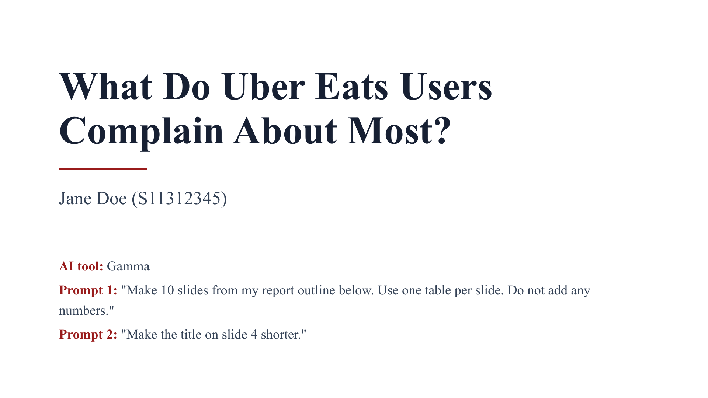

## Project Overview

**Project question:** What is the biggest problem customers have with one real app, and what one action should the company take?

**Purpose:** In this project, you practice using AI to **find**, **analyze**, and **solve** a real business problem:

- **Find the problem:** Use AI to collect real customer reviews, and find what customers complain about.
- **Analyze the problem:** Use AI to sort and count the complaints. Then check the AI's work yourself.
- **Solve the problem:** Use AI to list possible causes and actions. Then choose one action yourself and explain why.

AI is your tool. You make the final decisions, and you write the report.

You will:

1. **Get real data with AI.** Use Google Antigravity to download about 200 real Google Play reviews of one app.
2. **Analyze the data with AI.** Use ChatGPT to sort the reviews into complaint types.
3. **Check the AI yourself.** Count with Excel and read the reviews yourself. Find where the AI was wrong.
4. **Write the report yourself.** Make your own decision and explain it in your own words.

This project uses the same methods you learned in class:

| What you do | Session |
|---|---|
| Give the AI clear, structured prompts | 1.2, 1.3, 1.4 |
| Read the data before you decide; check every number | 2.1 |
| Improve a prompt by changing one thing at a time | 2.2 |
| Keep the scope small: one problem, one action | 2.3 |
| Every claim needs evidence; a group needs at least two pieces of evidence | 2.4 |
| Separate evidence from guesses | 3.2 |
| Remove personal details before you use AI | 3.4 |

### AI Use Rule

- You **may** use AI to collect data (Google Antigravity) and to analyze data (ChatGPT).
- You **may not** use AI to write, rewrite, translate, or correct any part of your report. You may use only the **spelling and grammar check in Microsoft Word** (Review > Spelling & Grammar). Do not use Copilot or "Rewrite" suggestions in Word.
- You **may** use an AI tool to make your slides. If you do, show the AI tool's name and your prompts on the title slide.
- Simple English is fine. Your own words matter more than perfect grammar.
- A report written by AI will receive **0 points** for the Report.

---

## Choose Your App

Choose **one** app from the list below. **Each student must choose a different app.** You will choose your app in class on **Monday, November 16, 2026**. The final list of students and apps will be posted on **iLearn**.

All apps are popular in the United States, so most of their reviews are in English. Download the reviews from the **United States** Google Play store (country code **us**), and use the **Package ID** in the table.

| # | App | Industry | Package ID |
|---|---|---|---|
| 1 | Uber | Ride-hailing | com.ubercab |
| 2 | Lyft | Ride-hailing | me.lyft.android |
| 3 | DoorDash | Food delivery | com.dd.doordash |
| 4 | Uber Eats | Food delivery | com.ubercab.eats |
| 5 | Instacart | Grocery delivery | com.instacart.client |
| 6 | Amazon Shopping | Online shopping | com.amazon.mShop.android.shopping |
| 7 | Walmart | Retail shopping | com.walmart.android |
| 8 | Target | Retail shopping | com.target.ui |
| 9 | eBay | Online marketplace | com.ebay.mobile |
| 10 | Temu | Cross-border shopping | com.einnovation.temu |
| 11 | SHEIN | Fashion shopping | com.zzkko |
| 12 | PayPal | Online payments | com.paypal.android.p2pmobile |
| 13 | Venmo | Mobile payments | com.venmo |
| 14 | Cash App | Mobile payments | com.squareup.cash |
| 15 | Netflix | Video streaming | com.netflix.mediaclient |
| 16 | Spotify | Music streaming | com.spotify.music |
| 17 | TikTok | Social media | com.zhiliaoapp.musically |
| 18 | CapCut | Video editing | com.lemon.lvoverseas |
| 19 | Airbnb | Home sharing | com.airbnb.android |
| 20 | Booking.com | Hotel booking | com.booking |
| 21 | Ticketmaster | Event tickets | com.ticketmaster.mobile.android.na |
| 22 | McDonald's | Fast food | com.mcdonalds.app |
| 23 | Starbucks | Coffee shop | com.starbucks.mobilecard |
| 24 | ChatGPT | AI assistant | com.openai.chatgpt |
| 25 | Duolingo | Education | com.duolingo |

Tips:

- Apps 1 and 2, 3 and 4, 7 and 8, 10 and 11, 13 and 14, and 19 and 20 compete in the same market. In your report, you may compare your app with its competitor in one or two sentences.
- Apps 13, 17, 18, 21, and 22 had star ratings below 4.0 on November 16, 2026, so they have many complaints. They are easier to analyze.

---

## Key Words

Learn these words before you start. Each example uses a food delivery app.

| Word | Meaning | Example |
|---|---|---|
| **Review** | What one customer wrote about the app, with a star score from 1 to 5 | R12: "My refund took three weeks." 1 star |
| **Category** | A name for one type of complaint | "Refund problem" |
| **Count** | How many reviews are in one category | 36 of 200 reviews |
| **Share** | Count divided by the total number of reviews | 36 ÷ 200 = 18% |
| **Low-star review** | A review with 1 or 2 stars | 80 of the 200 reviews have 1 or 2 stars |
| **Low-star share** | How much of the low-star reviews one category takes | 24 of the 80 low-star reviews are about refunds: 24 ÷ 80 = 30% |
| **Agreement** | How often your category and the AI's category are the same | Same for 17 of 20 reviews: 17 ÷ 20 = 85% |
| **Hypothesis** | A claim you believe but have not tested | "A clear refund button will reduce 1-star reviews." |

---

## Rules for the Analysis

1. **Use only the reviews.** Every claim needs at least one review ID (for example, R12). A claim with no review ID must be labeled "Hypothesis."
2. **Two reviews or more.** A category needs at least two reviews with the same complaint.
3. **Count it yourself.** Never copy a number from the AI without checking it in Excel.
4. **Change one thing at a time** when you improve a prompt. Write down what you changed.
5. **One problem, one action.** Choose one problem and recommend one action the company can do in 1 to 3 months.
6. **No personal details.** Do not download user names or profile pictures. Delete any name or phone number that appears inside a review.
7. **Do not ask AI for facts about the company** that are not in the reviews, such as sales or number of users. If you need a company fact, find it yourself on the company website and write the link.

---

## Project Steps

### Step 1: Choose Your App

- Choose one app in class. Check your app on iLearn after class.
- Read the app's Google Play page. Write down the company name, what the app does, and its star rating today.

### Step 2: Download the Reviews

Open Google Antigravity and send this prompt. Replace [Package ID] and [app name] with the information from the app table.

```text
Download the 200 newest Google Play reviews of the app [Package ID]
for the country us in English.
Save them as [app name]_reviews.csv with these columns:
review_id, date, score, content, reply.
Number the reviews R1, R2, R3, ... in the review_id column.
The reply column is the company's answer, if there is one.
Do not include user names or profile pictures.
```

**Worked example (Uber Eats):**

```text
Download the 200 newest Google Play reviews of the app com.ubercab.eats
for the country us in English.
Save them as uber_eats_reviews.csv with these columns:
review_id, date, score, content, reply.
Number the reviews R1, R2, R3, ... in the review_id column.
The reply column is the company's answer, if there is one.
Do not include user names or profile pictures.
```

Then check the file yourself:

- Open the CSV file in Excel. Are there five columns? Is there no user name column?
- Some reviews may not be in English, even though you asked for English. Delete them, because you will read, sort, and quote every review in English. Write down how many you deleted, so your reader knows how many reviews you downloaded and how many you analyzed. Example: "200 downloaded, 7 deleted (not in English), 193 analyzed."
- Write down the download date and the final number of reviews.

If the download does not work, try again once. If it still does not work, ask the instructor on iLearn.

### Step 3: Read the Data First

Do this **before** you use ChatGPT.

- Count how many reviews have 1, 2, 3, 4, and 5 stars. In Excel, use `=COUNTIF(C:C,1)`, `=COUNTIF(C:C,2)`, and so on.
- Read 20 low-star reviews. Write three complaints you see often.

**Example (fictional numbers):**

| Stars | Count | Share |
|---|---|---|
| 5 | 90 | 45% |
| 4 | 20 | 10% |
| 3 | 10 | 5% |
| 2 | 15 | 7.5% |
| 1 | 65 | 32.5% |
| Total | 200 | 100% |

**Submit Chapter 1 (Week 10: Friday, November 20, 2026, 5 pm).**

### Step 4: Make the Categories with ChatGPT

Upload your CSV file to ChatGPT and send **Poor Prompt 1**. Save the answer.

```text
Analyze these app reviews and tell me the main problems.
```

Start a **new chat**. Upload the file again and send **Improved Prompt 1**. Replace each [part].

```text
Here are [number] Google Play reviews of the [app name] app from the United States.
Each review has an ID (R1, R2, ...), a star score, and the text.
Use only these reviews.
Suggest 5 to 7 complaint categories.
For each category, give a one-sentence definition
and at least two review IDs as examples.
Do not make a category from only one review.
Do not count the reviews yet.
```

Now check the categories yourself:

- Open the example review IDs. Does each review really match the category?
- Do two categories mean the same thing? Join them.
- Does a category have only one real example? Remove it.

Write your final list of categories, each with a one-sentence definition.

### Step 5: Sort Every Review

In the same chat, send this prompt. Paste your final categories.

```text
Use only the categories below. Give each review exactly one category.
If no category fits, write "Other."
If the review has no complaint, write "No complaint."
Return a table with three columns: review_id, score, category.
Categories:
[paste your final categories with definitions]
```

Copy the table into a new column in your Excel file. Then check the AI yourself:

1. **Count each category in Excel.** Use `=COUNTIF(F:F,"Refund problem")`. For low-star reviews, use `=COUNTIFS(C:C,"<=2",F:F,"Refund problem")`. Compare your counts with any counts the AI gave.
2. **Check 20 reviews by hand.** Take every tenth review: R10, R20, R30, ... R200. Read each review and choose a category yourself, **before** you look at the AI's category. Then compare.
3. **Calculate the agreement.** Agreement = number of matches ÷ 20.

If the agreement is below 70%, improve your prompt by **changing one thing**, such as a clearer category definition. Run it again and compare. Write down what you changed and the new agreement. This is **Improved Prompt 2**.

**Example (fictional numbers):**

| Category | Count (Excel) | Share | Low-star count | Low-star share |
|---|---|---|---|---|
| Refund problem | 36 | 18% | 24 | 30% |
| Late delivery | 30 | 15% | 20 | 25% |
| App crashes | 18 | 9% | 14 | 17.5% |

### Step 6: Choose the Biggest Problem

Choose **one** category as the biggest problem. Use the count and the low-star share. Explain your choice in two or three sentences, and quote at least three reviews with their IDs.

Also read the company's replies (the reply column) for this category. Do the replies solve the problem? Write your judgment.


### Step 7: Recommend One Action

In a new chat, send this prompt. Replace each [part].

```text
The biggest problem in the [app name] reviews is [category].
It appears in [count] of [total] reviews.
Here are the reviews in this category:
[paste the reviews with their IDs]
Suggest three possible causes. Give review IDs as evidence for each.
Then suggest three actions the company could take in 1 to 3 months.
Label any claim that is not shown in the reviews as "Hypothesis."
Do not promise results you cannot support.
```

Now decide yourself:

- Choose **one** action. Explain why, with review IDs.
- Explain in one sentence each why you did **not** choose the other two.
- Write one hypothesis the company should test.
- Write one way to measure success. Example: "The share of 1-star reviews about refunds falls from 30% to below 20% in three months."

### Step 8: Write the Report and Record the Video

Write the final report **yourself**. Make the slides; if you use an AI tool, show its name and your prompts on the title slide. Record your 5-minute presentation (see [Presentation Video](#presentation-video)). See the next two sections for the report and the slides.

---

## Report Structure

Length: **at least 8 pages**, not counting the References and the Appendix. Save it as a PDF.

| Chapter | What to write |
|---|---|
| **1. Introduction and Data** | The company and the app (with the Google Play link); why you chose it; the project question; your download date, number of reviews, and how many you deleted (not in English); your star score table from Step 3 |
| **2. Method** | Poor Prompt 1, Improved Prompt 1, and Improved Prompt 2 with the one change you made; how you checked the categories; how you counted in Excel; how you checked 20 reviews by hand |
| **3. Results** | Your final categories; your category table (count, share, low-star share); your agreement result; at least one place where the AI was wrong; the biggest problem with at least three quoted reviews; your judgment of the company's replies |
| **4. Conclusion: "If I Ran This Company"** | Your one action and why; why you did not choose the other two; one hypothesis; one success measure; one limit of your data (for example, "Only 200 reviews from the United States") |
| **Appendix** | The full AI answers for every prompt, copied without changes |

In Chapters 1 to 4, write in your own words. When you use the AI's words, put them in quotation marks and write "(ChatGPT)."

---

## Report and Slide Format

### Report Format

- **Template:** Download the [Report Template](template.docx) and write your report in Microsoft Word.
- **Paper:** A4, with the margins in the template
- **Font:** Times New Roman 12 pt, line spacing 1.15
- **Length:** at least 8 pages, not counting the References and the Appendix
- **Chapters:** Use the headings in the template: 1. Introduction and Data, 2. Method, 3. Results, 4. Conclusion: "If I Ran This Company," References, and Appendix: AI Answers.
- **Tables and figures:** Give each one a number and a title above it. Example: "Table 1 Star scores of the Uber Eats reviews."
- **Prompts:** Copy each prompt exactly, and write its name above it (for example, "Improved Prompt 1").
- **File:** Save as a PDF.

### Slide Format

- **Tool:** There is no template. Design your slides your own way, in any tool you like (PowerPoint, Google Slides, Canva, or others).
- **Size:** 16:9
- **Number of slides:** at least 10
- **File:** Save as a PDF.

Suggested slides:

| Slide | Title | What to show | Time |
|---|---|---|---|
| 1 | Title | Your app, your name, and your student ID. If you used an AI tool for the slides, also the tool's name and your prompts | 1:00 |
| 2 | App Overview | The company, what the app does, and why you chose it | |
| 3 | Data | The download date, the number of reviews, and the star score table | |
| 4 | Complaint Categories | Your final categories, each with a short definition | 2:30 |
| 5 | Category Table | Count, share, and low-star share for each category | |
| 6 | How I Improved the Prompt | Poor Prompt 1 compared with Improved Prompt 1, and the one change in Improved Prompt 2 | |
| 7 | How I Checked the AI | Your agreement result and one place where the AI was wrong | |
| 8 | The Biggest Problem | The problem and two or three quoted reviews with their IDs | 1:00 |
| 9 | If I Ran This Company | Your one action, one hypothesis, and one success measure | |
| 10 | Summary | Three short points | 0:30 |

**AI tools for slides:** If you used an AI tool to make the slides, show the AI tool's name and your prompts on the title slide, as in @fig-title-slide.

{#fig-title-slide width=100%}

Use short phrases, not long sentences. Every number on a slide must come from your own Excel counts, even if an AI tool made the slides. Check every slide before you submit.

---

## Presentation Guidelines

### Final Presentations (Week 15: December 21, 2026, and Week 16: December 28, 2026)

- **Duration:** 6 minutes total: 5 minutes presentation and 1 minute Q&A
- **Attendance:** Mandatory
- **Slides:** at least 10 slides. Use the PDF you submitted in Week 14; you cannot change it on the presentation day.

### Presentation Structure (5 minutes)

| Section | Time |
|---|---|
| App overview and data: the company, the app, the reviews you downloaded, and the star score table | 1:00 |
| Review analysis: the categories, your category table, how you checked the AI, and where the AI was wrong | 2:30 |
| Recommendation: "If I Ran This Company," with the biggest problem, your one action, and its evidence | 1:00 |
| Summary | 0:30 |

Practice your presentation many times to stay within 5 minutes. Presentations will be stopped at 5 minutes.

### Presentation Video

- Record your 5-minute presentation in English.
- **Only you need to be in the video:** your face must be visible throughout. Slides are not needed in the video.
- **Sample video:** [A Plan Is Not a Strategy](https://youtu.be/iuYlGRnC7J8) (Harvard Business Review; @fig-sample-video). Watch it for the format:
  - One speaker, framed from the waist up, in the middle of the screen.
  - A plain, quiet background with nothing distracting behind the speaker.
  - The speaker looks at the camera and talks to the viewer, using natural hand gestures, without reading from a script.
  - Only a short caption with the speaker's name appears on screen. No slides.
- Upload the video to Google Drive. Set sharing to **"Anyone with the link"** with the role **Viewer**, and submit the link in iLearn by the Week 14 deadline.

{#fig-sample-video width=80%}

### Q&A Session (1 minute)

Be ready to answer questions about:

- Your data: where and when you downloaded it, and how many reviews you deleted (not in English)
- Your method: how you made and checked the categories
- Your evidence: what a review you quoted says (for example, "What does R45 say?")
- Your numbers: how you counted them and where the AI was wrong
- Your choice: why you chose this action and not another one

---

## Submission Requirements

You submit **two times**. Both deadlines are on a **Friday at 5 pm** (Taiwan time): **November 20, 2026** and **December 18, 2026**. Submit on iLearn.

**File names:** `FirstName` is your first name in English, and `StudentID` is your student ID. Example: `James_S1234567_Report.pdf`.

### Submission 1: Chapter 1 (Week 10: Friday, November 20, 2026, 5 pm)

| What to submit | File name |
|---|---|
| Report, Chapter 1 only (PDF) | `FirstName_StudentID_Ch1.pdf` |

Chapter 1 must include:

- [ ] The company and the app, with the Google Play link
- [ ] Why you chose this app
- [ ] The project question
- [ ] Your download date, the number of reviews, and how many reviews you deleted (not in English)
- [ ] Your star score table (Step 3)

Do **not** submit Chapters 2 to 4 yet.

### Submission 2: Final Report, Slides, and Video (Week 14: Friday, December 18, 2026, 5 pm)

| What to submit | File name |
|---|---|
| Final report, Chapters 1 to 4 and the Appendix (PDF) | `FirstName_StudentID_Report.pdf` |
| Slides, at least 10 slides (PDF) | `FirstName_StudentID_Slides.pdf` |
| Link to your 5-minute presentation video (Google Drive) | Paste the link in iLearn |
| Your review file with your categories (CSV) | `FirstName_StudentID_Reviews.csv` |

The final report must include:

- [ ] **Chapter 1: Introduction and Data**, improved after the Week 10 submission
- [ ] **Chapter 2: Method**
- [ ] **Chapter 3: Results**
- [ ] **Chapter 4: Conclusion: "If I Ran This Company"**
- [ ] **Appendix:** the full AI answers for every prompt

See **Report Structure** for what to write in each chapter.

### Presentations (Week 15: Monday, December 21, 2026, and Week 16: Monday, December 28, 2026)

You do not submit anything new. You must present with the **same slides you submitted in Week 14**. You **cannot change** your slides on the presentation day.

### Submission Process

1. **Convert to PDF:** Make sure both the report and the slides are in PDF format.
2. **Name your files:** Use the file names in the tables above.
3. **Check the video link:** Open it in a private browser window to make sure anyone can view it.
4. **Submit to iLearn:** Upload each file, or the video link, to the submission folder for that deadline.

### Important Notes

- **Late submissions will not be accepted.** Submit before the deadline.
- Only PDF format will be accepted for the report and slides.
- Make sure your files are not corrupted before you submit them.

---

## Evaluation

| Item | Points |
|---|---|
| Report | 20 |
| Slides | 20 |
| Presentation (in class, Week 15 or 16) | 60 |
| **Total** | **100** |

The presentation score is for your **in-class presentation** in Week 15 or Week 16. The presentation video is a **separate assignment**, graded outside this table. Submit its link by the Week 14 deadline.
